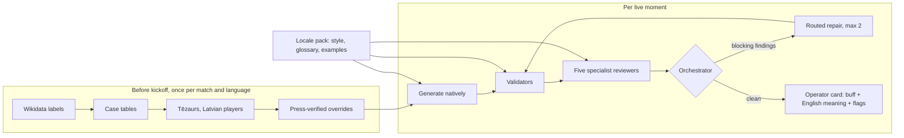

# How the Baltic buff pipeline works

This document explains every stage of the native-first pipeline in `bbl/`, the data it reads, the rules it applies, and how to extend it. For results and examples see `README.md` and `docs/examples.html`.

## The problem it solves

JIL buffs reach Lithuanian, Latvian and Estonian fans in two ways today. The editor's Translate button turns an English buff into the target language with a prompt that says to keep player and team names "as-is", which breaks the grammar: in these languages a name changes form depending on its role in the sentence. The newer `sports_native` prompt asks the model to write natively, but gives it no glossary, no reference spellings for names, no examples and no checks. The model guesses, and fans see calques ("soda kaste" for the penalty box), football verbs in hockey copy, and names in forms the local press never prints.

The pipeline fixes this by changing what the model works from and by checking every buff before an operator sees it. The model is the same; the inputs and checks are new.

## The flow for one buff



Name work happens before kickoff, so a live buff only pays for writing and review. In the measured runs that was a median of 13.5 seconds end to end with all-Claude reviewers (generation about 11 seconds, the five reviewers 2 to 4 seconds in parallel, validators under a second).

## Stage 1: reference names (`bbl/entities.py`)

Each sample event lists its teams and players with a Wikidata QID. `resolve()` calls the Wikidata `wbgetentities` API for labels and aliases in `en`, `mul`, `lt`, `lv` and `et`, and caches the result in `data/cache/wd_<qid>.json`.

Wikidata's language labels are curated by editors and already follow local conventions, for example lt "Kauno Žalgiris" and lv `Kauņas "Žalgiris"`. Player labels are often missing in lt and et since the 2024 move to a shared `mul` label, so `Entity.label()` falls back from the language label to `mul` to English and records which one it used.

The call uses `urllib` with a descriptive User-Agent. Wikimedia's bot filter returned 403 to the `httpx` client during testing.

## Stage 2: case tables (`bbl/inflect.py`, `bbl/tezaurs.py`, `bbl/press.py`)

A name needs a different form in each grammatical case. Lithuanian has 7 cases, Latvian is taught as 7 (6 with distinct endings), Estonian has 14. Instead of letting the model inflect names on the fly, the pipeline builds a table of every form once, the way a language-learning app stores a word's full paradigm.

1. **Draft.** `forms_for()` asks the model for an `EntityForms` object: the lemma, gender, whether the name declines, and for each case a full form and a short (surname or short club name) form. The prompt carries researched conventions per language. Lithuanian adds endings to consonant-final foreign names (Haalandas) but leaves vowel-final ones undeclined (Messi). Latvian respells foreign names phonetically (Mesi, Kampaco) and quotes club names with the city in the genitive (Madrides "Real"). Estonian keeps the original spelling, adds endings, and uses an apostrophe only where spelling and pronunciation clash.
2. **Rule-based Latvian forms.** For Latvian players, `tezaurs.inflect_phrase()` calls the public Tēzaurs morphology service (`morpho-api.tezaurs.lv`, no key) and overwrites the drafted forms where the service knows the name, for example Elvis Merzļikins → Elvja Merzļikina, Elvim Merzļikinam.
3. **Press overrides.** `press.apply()` layers `data/names/press.json` on top. Each entry was checked against native sports sites and carries a source URL:

```json
"lt": {
  "Q15238428": {
    "lemma": "Elvis Merzļikinas",
    "substitute": {"Merzlikin": "Merzļikin"},
    "cases": {"vardininkas": "Merzļikinas", "naudininkas": "Merzļikinui", "galininkas": "Merzļikiną"},
    "evidence": "Lithuanian press keeps the Latvian ļ and adds Lithuanian endings ...",
    "sources": ["https://www.sportas.lt/naujiena/535516/..."]
  }
}
```

`substitute` rewrites every form in the table, `cases` pins individual forms, and `evidence` is shown to reviewers and judges so a correct press form is never flagged as an error. The press check corrected two real errors in the drafted tables (lt "Merzlikinas" without the ļ, an Estonian genitive) and prevented a judge false positive (Latvian press does print "Donnarumma").

Tables are cached as `data/cache/forms_<lang>_<qid>.json`. Delete a file to rebuild it. A native editor can correct one by editing the JSON.

## Stage 3: the locale pack (`bbl/locale_pack.py`, `locales/`, `data/glossary/`)

Everything language-specific lives in plain files, so a linguist can change behaviour without touching code.

| File | What it holds | Used by |
|---|---|---|
| `locales/<lang>/style.md` | House style: register (informal "you", as Go3 uses), question particles (Ar / Vai / Kas), numeral agreement, plural-only nouns, club and name conventions, sport-specific verbs, typography, translationese tells | generator, judge, grammar and native-ear reviewers |
| `locales/<lang>/locale.json` | Machine facts for validators: quote style, banned quote marks, decimal separator, yes/no particle, minimum diacritic density, regex rules | validators |
| `locales/<lang>/fewshot.json` | Example buffs in house style (research drafts until natives review them) | generator |
| `data/glossary/<lang>.json` | About 50 sport terms per language with the preferred term, discouraged calques, sport, note, source URL and a `verified` flag | generator, validators, terminology reviewer, judge |

A glossary row looks like this:

```json
{"en": "power play", "term": "vairākums", "avoid": ["jaudas spēle", "spēka spēle"],
 "pos": "noun", "sport": "hockey", "note": "...", "source": "https://...", "verified": true}
```

`glossary_for(sport)` returns rows for the match's sport plus general terms; "ice hockey" maps to "hockey" and "soccer" to "football".

## Stage 4: native generation (`bbl/generate.py`)

`arm_baltic_draft()` sends one structured-output request. The system prompt is assembled in this order: the role (a senior sports-desk editor at a Baltic broadcaster who never translates from English), the card rules (title up to 35 characters, question up to 110, 2 to 4 short options), the style sheet, the sport-filtered glossary with its "NOT" forms, the case tables, and up to six examples. The user message holds only the match context: sport, competition, teams, score and state, the live moment, the requested buff type and the allowed facts.

The response must validate as `BuffDraft`:

```python
class Buff(BaseModel):
    buff_type: Literal["poll", "quiz", "prediction"]
    title: str            # card title, max 35 chars
    question: str
    options: list[str]    # 2 to 4
    correct_index: int | None
    reveal: str           # shown after the buff closes
    english_gloss: str    # literal English meaning for the operator

class BuffDraft(BaseModel):
    reasoning_notes: str  # which case each name and term takes, and why
    buff: Buff
```

`reasoning_notes` makes the model commit to case choices before writing. `english_gloss` lets an operator who doesn't speak the language check what the buff says. Calls go through `client.messages.parse(output_format=BuffDraft)`, so malformed output raises instead of reaching anyone. The stable system prompt is marked for prompt caching: the first buff per match and language writes about 13k cached tokens, and later buffs read them.

## Stage 5: validators (`bbl/validators.py`, `bbl/spell.py`)

Deterministic checks, no model call, under a second. Errors block the buff; warnings are passed along.

| Code | Severity | Catches |
|---|---|---|
| `len.title` | error | title over 35 characters |
| `len.question`, `len.option` | warn | question over 120 or an option over 32 characters |
| `opt.count`, `opt.dupe`, `opt.answer` | error | wrong option count, duplicates, a quiz without a valid answer |
| `ortho.foreign_letter` | error | a letter from another Baltic alphabet, such as a Latvian "ā" in Lithuanian copy (names exempt) |
| `ortho.no_diacritics` | error | diacritic density below the locale floor, which signals ASCII-folded text |
| `spell.unknown` | warn, sent to repair | a word missing from the Hunspell dictionary (lt_LT, lv_LV, et_EE via spylls + phunspell) |
| `term.calque` | error if the row is verified | a discouraged term from the glossary, matched by stem so inflected forms count |
| `locale.rule` | per rule | regex rules from `locale.json`, such as Latvian singular "vārts", Lithuanian "sekantis", Estonian "poolt" passives |
| `grammar.yesno` | warn | a yes/no question without its particle |
| `lang.english` | error | two or more English words outside names |
| `name.form` | warn | a capitalised word close to a known name but not in its case table |
| `typo.quotes`, `typo.decimal` | warn | wrong quote marks, decimal point instead of comma |

The calque check masks every inflected occurrence of the preferred term first. Without that, "soda sitiens" fired inside the correct "11 metru soda sitiens" and "pool" fired inside "poolaeg", which cost two wasted repair rounds per buff in round 2.

## Stage 6: the review team (`bbl/reviewers.py`)

Five specialist reviewers run in parallel at low effort. Each owns one error type and sees only the reference data it needs, which keeps prompts short and findings focused.

| Reviewer | Checks | Sees | Model |
|---|---|---|---|
| grammar | case government, agreement, numerals, question particle, word order | style sheet | Claude |
| terms | the sport term this country's broadcasters use, no calques, no terms from another sport | glossary | Claude |
| names | case form and club convention for every name | case tables, press evidence | Claude |
| native | anything that sounds translated or uses the wrong register; never sees the English | style sheet | Gemini chain, falls back to Claude |
| facts | score, who leads, period, quiz answer, option exclusivity, card length | match context | Claude |

Each returns a `Review` of `Finding` objects: severity, the exact span, the problem, a fix in the target language, and a confidence from 0 to 1.

The orchestrator is plain code, so every decision is logged and can be replayed. For each finding, in order:

1. Dismiss it if the span consists only of press-verified name forms.
2. Dismiss it if the span doesn't appear on the card (a hallucinated span).
3. Dismiss it if another reviewer already reported the same span.
4. Block if it is major or critical with confidence of 0.6 or more.
5. Otherwise keep it as advisory.

If anything blocks, `repair_brief()` groups the fixes by reviewer (facts, names, terms, grammar, native) and sends them, with any validator errors, to the generator. The next round re-runs only the reviewers that blocked, plus grammar, because any edit can break agreement elsewhere. In round 2, 14 of 18 buffs passed on the first draft.

## Stage 7: repair (`generate.arm_baltic_repair`)

The repair call sends the same system prompt, the match context, the previous draft and the list of problems, and asks the model to fix every one and re-check case and agreement on every changed word. `BBL_MAX_REPAIRS` caps the loop (default 2). After the cap the last draft goes to the operator with its flags attached; the pipeline never drops a buff on its own.

## Evaluation (`bbl/judge.py`): how the numbers were produced

The evaluation panel is separate from the pipeline and never gates a buff. Every approach is scored the same way, after it finishes:

- A fresh Claude judge (`BBL_JUDGE_MODEL`, high effort) reviews the card like an MQM annotator. It sees only the match facts, the card, the style sheet, the glossary and the press evidence, never the English source or which approach wrote it. It lists errors by category (grammar-case, grammar-agreement, terminology, name-form, fluency-translationese, accuracy-facts, style-register, spelling-diacritics, ui-fit) with a severity, and scores grammar, naturalness, terminology, faithfulness and engagement from 1 to 5. Approve means no major or critical errors.
- A second judge from another model family (`BBL_XJUDGE_MODEL`, Gemini) scores the same card to check for same-family bias.
- The MQM penalty weights errors 1 (minor), 5 (major) and 10 (critical).

In round 1, the round-1 pipeline was scored by the same judge it had just repaired against, which flattered it. Round 2 fixed that with the fresh panel score.

## The four approaches compared

| Arm | What it is | Where |
|---|---|---|
| A | Today's Translate button: English buff, then JIL's exact translate prompt | `generate.arm_translate` |
| B | Today's `sports_native` rules, read live from the backend prompt file, one call | `generate.arm_native` |
| C | Native-first pipeline: locale pack, case tables, validators, judge-driven repair | `pipeline.run_baltic` |
| D | C plus press-verified names, the five-reviewer team and the orchestrator | `pipeline.run_team` |

## Running it

```bash
cd baltic-buff-lab
uv sync
cp .env.example .env                      # keys fall back to ../backend/.env when blank
uv run pytest -q                          # 22 offline tests
uv run python -m bbl.cli entities samples/events/hockey_latvia_canada.json --forms
uv run python -m bbl.cli run samples/events/*.json --langs lt,lv,et --arms A,B,C,D
uv run python -m bbl.analyze out/run-<stamp>/results.json
PYTHONPATH=. uv run python tools/timing.py out/timing.json   # latency and cost per stage
python3 -I tools/build_examples.py        # docs/examples.html and docs/EXAMPLES.md
```

Each run writes `out/run-<stamp>/results.json` (every buff, issue, judgement, repair round and team decision) and `report.html`.

## Configuration

| Variable | Default | Purpose |
|---|---|---|
| `ANTHROPIC_API_KEY` | from `../backend/.env` | Claude calls |
| `GEMINI_API_KEY` | from `../backend/.env` | direct Gemini calls when no proxy token is set |
| `ACN_TOKEN`, `BBL_GEMINI_BASE_URL` | empty | optional pooled-key Gemini proxy that rotates keys on 429 |
| `BBL_GEN_MODEL` | `claude-opus-5-5` | generator for C and D, and the Claude reviewers |
| `BBL_BASELINE_MODEL` | `claude-sonnet-5-5` | generator for A and B |
| `BBL_JUDGE_MODEL` | `claude-opus-5-5` | evaluation judge |
| `BBL_XJUDGE_MODEL` | empty | second judge; `a\|b` tries models in order |
| `BBL_NATIVE_EAR_MODEL` | `gemini-3.6-flash\|gemini-3.5-flash-lite` | native-ear reviewer chain, then Claude |
| `BBL_GEN_EFFORT`, `BBL_JUDGE_EFFORT` | `medium`, `high` | effort levels |
| `BBL_MAX_REPAIRS` | `2` | repair rounds |
| `BBL_FALLBACKS` | `1` | server-side refusal fallback on Claude calls |

## Extending it

- **Add a sport term.** Add a row to `data/glossary/<lang>.json` with the preferred term, the forms to avoid and a source URL. Set `verified: true` only if you saw it in a source; verified rows make calques blocking.
- **Add a press-verified name.** Add an entry under the language and QID in `data/names/press.json` with `lemma`, optional `substitute` and `cases`, `evidence` and `sources`, then delete the matching `data/cache/forms_<lang>_<qid>.json`.
- **Add a style rule a regex can catch.** Add `{"pattern", "message", "severity"}` to `forbidden_patterns` in `locales/<lang>/locale.json`, then a test in `tests/test_validators.py`.
- **Add a language.** Add `locales/<lang>/` (style, locale facts, examples), `data/glossary/<lang>.json`, the case list in `inflect.CASES`, the alphabet in `validators.ALPHABET_EXTRA`, the Hunspell code in `spell.CODES` and the name in `config.LANG_NAMES`.
- **Add a sport.** Add glossary rows with that `sport` value, examples, and an event in `samples/events/`.
- **Add a reviewer.** Add a `Specialist` to `reviewers.team()` with its brief and the reference blocks it needs; the orchestrator picks it up automatically.

## What we measured

Round 2, all generation on `claude-opus-5-5`, 18 buffs per approach, scored by the independent panel:

| | B today's native | C native-first | D review team |
|---|---|---|---|
| Approved by the Claude judge | 7/18 | 17/18 | 17/18 |
| Approved by the Gemini judge | 6/11 | 7/10 | 15/17 |
| Approved by both | 4/11 | 7/10 | 14/17 |
| Major and critical errors | 21 | 3 | 1 |

Gemini answered for 38 of 54 buffs; the rest hit overload errors. Approach A on the same model was approved 5 of 18 times with 30 major errors.

## Known limits

- The Claude judge reads the same style sheet as C and D, which can favour them. The Gemini judge offsets this partly; native raters are the real test (protocol in `research/03`).
- The examples and several style rules are research drafts that no native speaker has reviewed yet.
- 18 buffs per approach from three simulated matches show the direction, not a benchmark.
- Gemini Flash returned overload errors often enough that one review took 200 seconds. Keep it off the live path.
- One open question for a native speaker: whether Lithuanian declines "Donnarumma" ("prieš Donnarummą").
